<p align="center">
  
</p>

<p align="center">
  <strong>A practical starting point for helping maintain the public interest web.</strong><br>
  Python · Common Crawl · RuVector · ruOS
</p>

<p align="center">
  <a href="#start-here">Start here</a> ·
  <a href="#what-we-have-proved">Measured results</a> ·
  <a href="#how-it-works">How it works</a> ·
  <a href="#from-candidate-to-review">Evidence review</a> ·
  <a href="#where-to-go-next">Documentation</a>
</p>

## What AngelNet does

AngelNet helps maintenance teams discover PHP website candidates, preserve the evidence behind each candidate and identify what must be checked before a repair decision.

The starting point is public archive data. Give AngelNet a domain scope or a downloaded archive file. It produces a private index of captured URLs, dates and sources, plus a review queue that makes missing deployment facts explicit. Local RuVector retrieval helps search extracted page text by similar wording.

The purpose is to make useful websites easier to care for, especially in health, humanitarian work and community services. A charity portfolio, a public health archive or a hosting provider's customer estate can become a reviewable set of records instead of an unqualified list of supposedly vulnerable sites.

**Working early release, version 0.2.0.** Discovery, indexing, lexical retrieval and evidence review work today. Vulnerability assessment and automated repair are future work. No site has been established as unmaintained for twenty years.

## What we have proved



A bounded medical and humanitarian pilot searched three domain scopes in Common Crawl collection `CC-MAIN-2026-43`. The static index path completed on ruOS and produced the same candidate export as the local run.

| Measured outcome | Result |
| :--- | ---: |
| Captures inside the selected scope | 13,465 |
| Retained PHP observations | 43 |
| Candidate hostnames | 4 |
| Requests to candidate websites | 0 |
| First ruOS run | 7.319 seconds, 101.6 MiB downloaded |
| Cached ruOS repeat | 5.977 seconds, 1.96 MiB downloaded |
| Candidates needing owner inventory | 4 |

The four hostnames belong to one organization. Their retained captures date from October 5 through October 15, 2026. This proves a working discovery path and reproducible evidence, not population coverage, neglect or vulnerability. These are individual runs, not throughput guarantees.

[Discovery evidence](docs/evidence/static-pilot.json) · [Review evidence](docs/evidence/review-pilot.json) · [Pilot method and limits](docs/STATIC.md)

## Start here

Choose the path that fits the evidence you have:

| Your starting point | Run | What you receive |
| :--- | :--- | :--- |
| A domain portfolio | `cc_static.py` | Archived PHP candidates and source receipts |
| A candidate export | `review_queue.py` | Missing evidence and the next review stage |
| Downloaded page text | `wet_import.py` and `wet_vectors.mjs` | A local text corpus and lexical retrieval |

Python 3.10 or newer runs discovery and review with no third party Python packages. Node.js 20 or newer is required only for RuVector retrieval.

```sh
git clone https://github.com/ruvnet/AngelNet.git
cd AngelNet
```

### 1. Discover a scoped set of candidates

Replace `example.org` with a domain you want to review. Repeat `--domain` for up to 20 scopes.

```sh
python3 cc_static.py \
  --domain example.org \
  --collection CC-MAIN-2026-43 \
  --blocks-per-domain 10 \
  --max-requests 31 --max-seconds 120 \
  --out output/static
```

This uses Common Crawl's published index files directly. The first run caches approximately 100 MiB for this collection; later runs in the same output directory reuse that file. The default total download cap is 144 MiB. No candidate website is contacted.

Open `output/static/sites.csv` for the candidate list and `output/static/static-run.json` for coverage, errors and source hashes. Exit code `0` means the bounded sample completed, including an empty sample. Exit code `2` means partial work or an error. An empty export after a provider failure says nothing about how many sites exist.

### 2. Identify the next missing fact

```sh
python3 review_queue.py \
  --sites output/static/sites.jsonl \
  --out output/review
```

Without deployment facts, candidates stay at `needs_owner_inventory`. When an owner or hosting provider supplies an export, add `--inventory owner-inventory.json`. The [illustrative inventory template](samples/owner-inventory.example.json) describes the fields; placeholders are not evidence.

Open `output/review/review.csv`. A complete supplied inventory can reach `ready_for_advisory_review`. It cannot automatically become a confirmed vulnerability. Use a new review output directory for each run.

For a small offline demonstration that makes no network requests:

```sh
python3 review_queue.py \
  --sites samples/review-sites.example.jsonl \
  --out output/review-demo
```

That fixture is synthetic. The expected result is one `needs_owner_inventory` record, zero network requests and zero confirmed vulnerabilities.

## How it works


1. **Discover.** Input is a domain scope, CDX export or local WET file. Output is a bounded set of archive observations. Coverage is assumed to be incomplete.
2. **Preserve.** Input is an eligible capture. Output is normalized evidence in SQLite, with source identity and capture dates. Query strings and fragments are removed; remaining paths and page text may still contain identifiers.
3. **Retrieve.** Input is extracted WET text. Output is local RuVector search results. Similar wording helps locate relevant content; it does not measure security or charitable purpose.
4. **Review.** Input is a candidate export plus optional owner supplied deployment facts. Output is a list of missing evidence and a review stage. Supplied facts remain unverified assertions until independently checked.

Metadata review does not require a vector database. WET retrieval is a separate path, and a CDX discovery run does not automatically download page bodies.

| Format | What it contributes | Boundary |
| :--- | :--- | :--- |
| CDXJ | URLs, capture dates and archived response metadata | Only what the selected collection contains |
| WET | Extracted text and archive record metadata | No original HTTP headers or full HTML |
| WAT / WARC | Richer metadata or original archived responses | Importers are planned |

CDXJ offsets for archived responses refer to WARC records, not WET byte positions. [Common Crawl format guide](https://commoncrawl.org/get-started)

## From candidate to review



A useful repair decision needs the serving runtime, its exact package build and the applicable maintenance history. A command line PHP version may belong to a different installation. A twenty year old page can run on a fully updated server.

The review queue records the next missing fact, with defaults of **7 days** for inventory freshness and **90 days** for archive recency. Those are configurable policies, not accuracy guarantees. PHP branch support comes from a dated [official lifecycle snapshot](data/php-support.json); once the snapshot expires, its status becomes unknown until refreshed.

| Review state | What happens next |
| :--- | :--- |
| `needs_owner_inventory` | Obtain the corresponding owner or hosting export |
| `needs_authorization_record` | Record the applicable authorization reference |
| `needs_web_runtime_evidence` | Establish which runtime serves this hostname |
| `needs_fresh_inventory` | Refresh stale deployment observations |
| `needs_build_provenance` | Supply version, vendor, package build and evidence reference |
| `ready_for_advisory_review` | Independently check the supplied facts against applicable advisories |

Every state retains `vulnerability_status: not_assessed`, `patch_status: not_assessed` and `owner_identity: not_verified`. The current software does not authenticate an owner or perform advisory matching. [Full review contract](docs/REVIEW.md)

## Evidence before conclusions


An archived PHP path is a discovery signal. Its suffix does not establish the current runtime version. Its capture date does not establish the last software update. A search score does not establish a vulnerability probability. Unknowns remain visible in the exported record.

```json
{
  "host": "example.org",
  "review_stage": "needs_owner_inventory",
  "inventory_trust": "not_supplied",
  "vulnerability_status": "not_assessed",
  "maintenance_status": "unknown",
  "patch_status": "not_assessed",
  "owner_identity": "not_verified"
}
```

This is an illustrative subset of a review record. The largest accuracy risk is mistaking historical content for present neglect. The fix is independently checked deployment evidence and evaluation against known maintenance histories. Clean URLs can also hide PHP applications from suffix based discovery, so recall remains unknown.

## Search archive text with RuVector

AngelNet pins native **RuVector 0.2.25** and uses normalized **384 dimensional character trigram vectors**. This is lexical similarity. Every build and search explicitly reports `semantic_model: false`. Transformer semantic retrieval is not implemented; the inspected ONNX path failed to load.

The smallest real format check downloads Common Crawl's official 3,006 byte WET sample, verifies its checksum, parses its text and searches a persisted vector store:

```sh
npm ci --ignore-scripts --no-audit --no-fund
python3 scripts/fetch_sample.py

python3 wet_import.py \
  --wet samples/whirlwind.warc.wet.gz \
  --all-text --out output/wet-sample

node wet_vectors.mjs build \
  --input output/wet-sample/wet-documents.jsonl \
  --store output/wet-sample/vectors

node wet_vectors.mjs search \
  --store output/wet-sample/vectors \
  --query 'Escopete' --k 1
```

Expected: two WARC records, one text document, one persisted vector and one search hit. The page is from Wikipedia and produces **zero PHP candidates**. This validates parsing and persistence, not discovery accuracy or semantic relevance.

Use a fresh vector directory for each build. With your own downloaded WET segment, omit `--all-text` to retain only PHP paths, and optionally supply a domain filter. [WET parsing, provenance and model contract](docs/WET.md)

## Operating bounds and cost

| Path | Default bounds | Network behavior |
| :--- | :--- | :--- |
| Static discovery | 10 blocks per domain, 40 requests, 144 MiB total download budget | Reads Common Crawl's data host |
| Metadata API | 100 records, 20 requests, 180 seconds | Reads Common Crawl or Wayback |
| WET import | 64 MiB file and decompression caps, 10,000 records, 1,000 documents | Reads a local file |
| Vector build | First 1,000 input lines; input file up to 100 MiB | Local native backend |
| Evidence review | 5 MiB per input file; up to 10,000 sites | Offline |

Commands can override the defaults within explicit limits. Time budgets are cooperative; a supervisor such as ruOS provides a stricter process deadline. No paid API or language model is required. Existing compute and network charges depend on where you run the scripts.

For scale, one million 384 dimensional float32 vectors require **1.536 GB for raw values alone**, before search structures, metadata and text. Filter before indexing. For broad discovery across thousands of domains, evaluate the columnar index instead of running unbounded public API loops. [Common Crawl bulk guidance](https://index.commoncrawl.org/)

## Outputs you can inspect

| Output | Use it to |
| :--- | :--- |
| `index.sqlite3`, `sites.csv`, `sites.jsonl` | Inspect candidates, capture history and source references |
| `static-run.json`, `last_run.json`, `runs/` | Audit scope, limits, downloaded blocks and errors |
| `wet-documents.jsonl`, `wet-run.json` | Inspect extracted text and parser provenance |
| `vectors/manifest.json` | Check model identity, dimensions and persistence |
| `review.csv`, `review.jsonl`, `review-run.json` | Find evidence gaps and trace the review inputs |

Exports can include records from previous runs in the same database. Compare `observations_added` with `sites_total`. The latest WET receipt is replaced on a repeat import, so preserve it separately when keeping a run history.

Keep generated output private until reviewed. The repository ignores the usual output directories, databases and downloaded archives. No candidate list is automatically published or sent to site owners. [Security and data handling](SECURITY.md)

## Validation

**45 Python tests and one native RuVector integration test** passed locally and in CI. The review and static discovery additions were also tested on ruOS. Native retrieval checks persistence and ranking across separate processes; it does not claim semantic relevance on a labelled evaluation corpus.

```sh
npm ci --ignore-scripts --no-audit --no-fund
npm test
npm run check:docs
```

CI uses local fixtures and does not depend on archive availability. The optional sample download and the measured discovery pilot are separate network checks. The five SVG illustrations have accessible descriptions, readable static states and reduced motion support. Regenerate them with `python3 scripts/generate_svgs.py`.

[Original validation](docs/evidence/validation.json) · [Static discovery validation](docs/evidence/static-pilot.json) · [Review validation](docs/evidence/review-pilot.json)

## What comes next

The next useful milestone is a pilot with **ten consenting organizations**, each supplying independently checked deployment facts. That gives us a way to measure false positives, false negatives and unknowns against actual maintenance need.

After that: advisory matching with vendor patch provenance, WARC evidence enrichment, evaluated semantic retrieval and a separate repair workflow with isolated copies, regression tests and successful backup restoration. These are planned capabilities. [Ranked improvement plan and acceptance criteria](docs/REVIEW.md)

## Where to go next

| Guide | Contents |
| :--- | :--- |
| [Static discovery](docs/STATIC.md) | Direct index access, range validation, caching and pilot results |
| [Evidence review](docs/REVIEW.md) | Inventory schema, freshness, review states and improvement priorities |
| [WET and RuVector](docs/WET.md) | Byte framed parsing, text provenance, retrieval and limits |
| [Operations](docs/OPERATIONS.md) | API discovery, offline imports, ruOS execution and recovery |
| [Contributing](CONTRIBUTING.md) | Validation commands and contribution boundaries |
| [Security](SECURITY.md) | Untrusted archive content and private output handling |

No project distribution license has been selected yet. Dependencies and downloaded archive content retain their respective licenses and attribution requirements.
