<p align="center">
  
</p>

<p align="center"><strong>Good deeds done. Start with evidence.</strong></p>

AngelNet helps find legacy PHP sites that deserve a closer look. It turns public archive metadata and extracted page text into a private, searchable index with source URLs, capture dates and explicit uncertainty.

The aim is to make neglected software easier to discover and eventually repair. The current release delivers discovery and indexing. It does not patch websites or determine whether they are vulnerable.

**Status: early working release, version 0.2.0.** Live discovery now works through Common Crawl's static index files, including a successful ruOS pilot. The parser, deduplication, persistence and native vector retrieval have also been tested. Archive coverage remains incomplete, and no verified inventory of sites unmaintained for 20 years has been produced.

## Why AngelNet exists

A website can remain useful long after its original developer has left. Before anyone can repair it, someone needs to establish what exists, where it came from and which assumptions still need checking.

AngelNet makes that first step reproducible. A hosting provider can review a domain portfolio. A preservation project can organize historical sites. A maintenance team can collect evidence before requesting owner access. Each candidate carries provenance instead of an unexplained risk score.

An old capture proves that content was archived at that time. It does not prove that today's site uses the same software, has the same owner or has gone without updates. That distinction is part of the data model.

## What works today

| Capability | Current behavior |
| :--- | :--- |
| Common Crawl discovery | Query a bounded CDX page for each supplied domain, including subdomains |
| Static index fallback | Cache a pinned Common Crawl index and read scoped gzip blocks directly when the query API fails |
| Historical discovery | Query Wayback for PHP captures older than a configurable age threshold |
| Offline metadata import | Read local CDX JSONL when providers are unavailable or discovery happened elsewhere |
| WET ingestion | Stream local plain or gzip WET records using byte lengths and explicit limits |
| Candidate index | Deduplicate observations in SQLite and export CSV and JSONL |
| Text retrieval | Store 384 dimensional lexical vectors in native RuVector and search across processes |
| Execution evidence | Record scope, limits, source identity, errors and completion status |
| Offline review queue | Identify missing owner inventory, web runtime evidence, build provenance and stale observations |
| ruOS execution | Run the same scripts through the desktop executor with an explicit machine and timeout |

**Not implemented:** runtime inspection, vulnerability confirmation, automated patching, production deployment to candidate sites, transformer semantic retrieval or continuous monitoring.

Discovery and assessment are separate. The [review queue](docs/REVIEW.md) accepts owner supplied deployment facts, records their provenance and identifies the next missing evidence. It does not authenticate those facts or match advisories yet.

## Quick start

Requirements: Python 3.10 or newer. Node.js 20 or newer is needed only for RuVector retrieval. The metadata indexer and WET parser use the Python standard library.

```sh
git clone https://github.com/ruvnet/AngelNet.git
cd AngelNet
python3 angel_index.py --help
```

### 1. Discover within a domain scope

Replace `example.org` with the domain you want to review:

```sh
python3 angel_index.py \
  --domain example.org \
  --wayback \
  --out output
```

The default source is the latest Common Crawl collection. `--wayback` adds historical enrichment for up to ten indexed hosts. Repeat `--domain` for up to 20 domain scopes. This reads public archive metadata; it makes no requests to the candidate websites.

To discover historical PHP paths directly through Wayback:

```sh
python3 angel_index.py \
  --source wayback \
  --domain example.org \
  --years 20 \
  --out historical-output
```

Exit code `0` means the bounded sample completed, including an empty sample. Exit code `2` means invalid arguments or partial work. Read the receipt before interpreting a zero result.

### When the archive query API times out

Use the static index path. It contacts only Common Crawl's data host and does not require the query API or Wayback:

```sh
python3 cc_static.py \
  --domain example.org \
  --collection CC-MAIN-2026-43 \
  --blocks-per-domain 10 \
  --max-requests 31 --max-seconds 120 \
  --out output/static
```

The first run caches approximately 100 MiB for this collection. Later runs in the same output directory reuse that file and download only selected compressed blocks. The default total download cap is 144 MiB. Coverage and checksums are recorded in `static-run.json`.

A medical and humanitarian pilot examined 13,465 scoped captures, retained 43 PHP observations across four hostnames and completed on ruOS in 7.319 seconds. It made eight archive requests and zero requests to the selected websites. Those observations were captured in October 2026; none establish twenty years without maintenance. [Static discovery guide and measured evidence](docs/STATIC.md)

### 2. Parse WET and search with RuVector

This reproducible example fetches Common Crawl's official 3,006 byte format sample, verifies its SHA256 digest, parses its text and builds a local vector index:

```sh
npm ci --ignore-scripts --no-audit --no-fund
python3 scripts/fetch_sample.py

python3 wet_import.py \
  --wet samples/whirlwind.warc.wet.gz \
  --all-text \
  --out sample-output

node wet_vectors.mjs build \
  --input sample-output/wet-documents.jsonl \
  --store sample-output/vectors

node wet_vectors.mjs search \
  --store sample-output/vectors \
  --query 'Escopete' \
  --k 1
```

Expected result: two WARC records, one extracted text document, one persisted vector and one search result. The sample is a Wikipedia page, so it produces **zero PHP candidates**. It validates the pipeline without pretending to demonstrate discovery of neglected sites.

Use a fresh vector directory for each build. Repeating the WET import deduplicates documents, but repeating a vector build into an existing directory is intentionally rejected.

For your own downloaded segment, omit `--all-text` to retain only PHP URL candidates:

```sh
python3 wet_import.py \
  --wet segment.warc.wet.gz \
  --domain example.org \
  --out output
```

Full segments may exceed the default 64 MiB input cap. Increase `--max-bytes` explicitly when needed; the maximum supported value is 1 GiB. No full crawl is downloaded automatically.

## How the pipeline works



1. **Select scope.** Input is a domain list, a CDX export or a downloaded WET file. Output is a bounded set of records. Archive coverage is assumed to be incomplete.
2. **Parse and filter.** Input is untrusted archive data. Output is normalized URLs, valid capture dates and eligible records. A PHP path is a signal, not proof of the installed runtime.
3. **Preserve evidence.** Input is an accepted observation or text document. Output is durable SQLite data with source identity. WET records retain file and payload hashes plus WARC record identifiers.
4. **Retrieve and review.** Input is the stored corpus and a text query. Output is candidate records with their evidence. Similarity ranks content; it does not assess security.

The metadata and text paths complement each other. CDX is useful for discovery by URL and date. WET provides text for retrieval. Original HTTP response details require WAT or WARC. [Common Crawl format guide](https://commoncrawl.org/get-started)

### Turn candidates into an evidence queue

```sh
python3 review_queue.py \
  --sites output/static/sites.jsonl \
  --out output/review
```

Without deployment inventory, each candidate stays at `needs_owner_inventory`. Add `--inventory owner-inventory.json` only when you have the corresponding owner or hosting export. The [illustrative template](samples/owner-inventory.example.json) shows the fields; its placeholders are not evidence.

The default freshness windows are 7 days for supplied deployment inventory and 90 days for archive observations. These are configurable review policies, not accuracy guarantees. A complete supplied inventory can reach `ready_for_advisory_review`; it never becomes a confirmed vulnerability automatically. PHP branch support is checked against a dated official snapshot with an expiry date, separately from patch status.

| Archive format | Useful evidence | Important limit |
| :--- | :--- | :--- |
| CDX | Capture URL, timestamp, status and MIME metadata | Limited to what the selected index contains |
| WET | Extracted text, target URL, date and record identifiers | Original HTTP headers and HTML are absent |
| WAT | Extracted response metadata and page structure | Not currently imported by AngelNet |
| WARC | Original archived requests and responses | Not currently imported by AngelNet |

Common Crawl's CDX offsets point into WARC files. They are not interchangeable with WET offsets. See the [official archive tour](https://github.com/commoncrawl/whirlwind-python).

## Evidence before conclusions



An illustrative candidate looks like this. The domain and dates below are examples, not a discovered site:

```json
{
  "host": "forum.example.org",
  "php_signal": "archived_php_path",
  "first_observed": "20060101120000",
  "last_observed": "20261001120000",
  "archive_age_at_least_years": 20,
  "review_priority": "historical_php_review",
  "maintenance_status": "unknown",
  "runtime_version": "unknown",
  "vulnerability_status": "not_assessed",
  "current_reachability": "not_checked",
  "identity_continuity": "unknown"
}
```

`historical_php_review` means at least one retained PHP URL capture is older than the selected threshold. It is not a vulnerability score. `first_observed` means the earliest retained observation, not necessarily the first capture ever made.

These rules stay true throughout ingestion and retrieval:

1. No capture date becomes a claimed software update date.
2. No PHP suffix becomes a claimed runtime version.
3. No retrieval score becomes a security confidence score.
4. No provider failure becomes a successful empty discovery result.
5. No WET record receives an invented HTTP status. Its status is `not_in_wet`.
6. No generated candidate list is automatically published or sent to site owners.

The largest accuracy risk is mistaking historical content for present neglect. The fix path is owner or host verification of current software, package provenance and maintenance history. Clean URLs can also hide PHP sites from suffix based discovery, so recall is unknown.

## Outputs and provenance

| File or table | Purpose |
| :--- | :--- |
| `index.sqlite3` | Deduplicated observations and, after WET import, text documents |
| `sites.csv` | One row per indexed hostname for review in a spreadsheet |
| `sites.jsonl` | Site records with up to five evidence examples each |
| `last_run.json` | Latest metadata discovery scope, counts, limits and errors |
| `runs/` | Individual metadata execution receipts |
| `wet-documents.jsonl` | Extracted text with capture and source metadata |
| `wet-run.json` | Latest WET execution receipt, replaced on each import |
| `static-run.json` | Static index scope, selected block counts, byte ranges, hashes and errors |
| `review.jsonl`, `review.csv` | Evidence gaps and review stage per candidate |
| `review-run.json` | Input hashes, freshness policies, stage counts and snapshot provenance |
| `vectors/manifest.json` | Embedding identity, dimensions, count and persistence check |

Exports include prior records in the same SQLite database. A run that adds zero observations can still export existing candidates. Compare `observations_added` with `sites_total` when reviewing progress.

URL query strings and fragments are removed. Paths and page text can still contain identifiers. Store generated output privately and inspect it before sharing. The repository ignores databases, downloaded samples and common output directories; use the same care with custom paths.

## RuVector: what is measured and what is not

AngelNet pins `ruvector` to **0.2.25** and requires its native backend for vector operations. Each document receives a normalized **384 dimensional character trigram vector** through RuVector's `LocalNGramProvider`.

This is **lexical similarity**. It is useful for matching related wording and template text. It does not have transformer semantics. Build and search results explicitly report `semantic_model: false`, and querying with a mismatched model manifest is rejected.

The installed ONNX paths were checked during development. The standalone package failed to load because of a CommonJS binding inside an ES module package. Semantic retrieval needs a corrected, pinned runtime, a separate store and relevance tests before it can be claimed working.

The architecture draws on [RuVector ADR 120](https://github.com/ruvnet/RuVector/blob/46d816ddc4c2a8a06cd3613534a79b1d557d858b/docs/adr/ADR-120-wet-processing-pipeline.md). AngelNet uses local storage and byte framed parsing in place of that workflow's shared brain injection and line based record detection. Upstream throughput claims are not AngelNet benchmarks.

## Limits, cost and scaling

| Operation | Default limit |
| :--- | :--- |
| Metadata discovery | 100 examined records and 20 provider requests |
| Provider pacing | At least 2 seconds between request starts |
| Metadata time budget | 180 seconds, with a 15 second socket timeout |
| Provider response size | 2 MB per response |
| WET input and decompressed data | 64 MiB each |
| WET scanning | 10,000 records and 1,000 matched documents |
| WET body and retained text | 2 MB per body and 8,000 characters per document |
| Vector build | First 1,000 JSONL lines, configurable up to 10,000 |
| Vector input file | 100 MiB |

Time budgets are cooperative. A blocking read can overrun the deadline by a socket timeout. Use the ruOS executor or another process supervisor for a stricter limit.

No paid APIs or language model calls are required. Existing host and network charges depend on where you run the scripts. One million 384 dimensional float32 vectors require **1.536 GB for raw values alone**, before graph, metadata and page text. Filter before indexing and partition larger workloads.

For discovery across the web, use Common Crawl's columnar index or a separately prepared dataset, then import a bounded selection. The public CDX service is not intended for whole web download loops. [Common Crawl bulk guidance](https://index.commoncrawl.org/)

## Offline import and repeatable sampling

```sh
python3 angel_index.py \
  --input captures.jsonl \
  --limit 1000 \
  --out output
```

Each line must contain `url` or `original`, `timestamp` as UTC `YYYYMMDDhhmmss`, `status` or `statuscode`, and `mime` or `mimetype`. The CDX importer retains status 200 HTML records with eligible PHP paths. Input provenance includes the hash of the consumed prefix. Keep the original source separately.

For Common Crawl page sampling, pin the collection and change `--page` deliberately:

```sh
python3 angel_index.py \
  --domain example.org \
  --collection CC-MAIN-2026-43 \
  --page 1 \
  --out output
```

Pages can overlap after filtering. Repeated observations deduplicate; the result remains a bounded sample, not an exhaustive inventory.

## Run on ruOS

The scripts are ordinary Python and Node programs. ruOS supplies the execution host and audited command channel.

1. Use ruOS `desktop_status` to select a running desktop. A provisioning flag alone is not proof the machine is available.
2. Clone the repository into a task directory on that desktop and install dependencies if vector retrieval is needed.
3. Use `desktop_exec` with the explicit machine ID and a bounded command, for example:

```sh
cd /path/to/AngelNet
python3 angel_index.py --domain example.org --max-seconds 90 --max-requests 6 --out output
```

4. Set the executor timeout to 120 seconds for that command. Verify its completion and read the output receipt.

No schedule is created. No machine is provisioned. Credentials, machine identifiers and private execution transcripts are not required in this repository.

## Validation and known limits

The development acceptance record contains:

1. **45 Python tests** passing locally, including static index selection and review evidence boundaries. The original 27 tests and the static tests have also been exercised on ruOS; review deployment evidence is documented separately in the [review guide](docs/REVIEW.md).
2. **One native RuVector integration test** passing on both hosts, checking persistence and retrieval across separate processes, provenance and rejection of a model mismatch.
3. **One real Common Crawl sample** parsed, indexed and searched on ruOS. It contains one text document and zero PHP candidates.
4. **Unsuccessful live discovery controls:** Common Crawl returned HTTP 504 and Wayback returned HTTP 503. Those attempts collected no candidates and were recorded as partial.
5. **Successful static discovery:** a three domain ruOS pilot produced 43 PHP observations across four hostnames, with candidate exports identical to the local run. [Measured static pilot](docs/evidence/static-pilot.json)

The single document run measured approximately 7 ms for parsing, 23 ms for index construction and 11 ms for reopening and querying within the Node process. These are small format checks, not capacity or search quality benchmarks. See the [sanitized validation record](docs/evidence/validation.json).

Still unverified: accuracy against independently known maintenance histories, semantic relevance and sustained operation on large WET segments.

Run the acceptance suite:

```sh
npm ci --ignore-scripts --no-audit --no-fund
npm test
npm run check:docs
```

The CI workflow runs those checks without contacting archive providers. The optional official sample download is a separate network step.

## Recovery

| Symptom | Next action |
| :--- | :--- |
| HTTP 429 or 503 | Stop calls to that provider and inspect the partial receipt |
| HTTP 504 or timeout | Treat coverage as incomplete; use `cc_static.py` or a local archive export |
| Output lock exists | Check the earlier process before removing `.lock` |
| Vector directory already exists | Choose a fresh store directory; keep the earlier result intact |
| Native backend unavailable | Check the supported platform and reinstall from the lockfile |
| WET record or byte budget exceeded | Inspect the partial receipt and choose a deliberate larger bound or smaller input |

SQLite observations commit in batches. Exports are individually replaced atomically, so interruption can leave exports from different runs until a successful rerun. A vector build without its manifest is incomplete. Archive visibility and provider availability are not under AngelNet's control.

## Next milestones

1. Validate the evidence queue with ten consenting organizations and owner supplied deployment facts.
2. Add advisory matching for exact packages and builds, including vendor patch provenance and vulnerability prerequisites.
3. Add WAT or WARC evidence for archived response headers and application markers.
4. Repair the semantic embedding runtime and evaluate retrieval on labelled examples before scaling WET processing.
5. Design a separate authorized repair workflow with isolated copies, regression tests and recovery evidence. See the [ranked improvement plan](docs/REVIEW.md).

## Contributing and licensing

Read [CONTRIBUTING.md](CONTRIBUTING.md), [SECURITY.md](SECURITY.md) and the [WET implementation notes](docs/WET.md). Keep fixtures small, preserve source attribution and distinguish test evidence from live results.

No project distribution license has been selected yet. Dependencies and downloaded archive content retain their respective licenses and attribution requirements.

The animated SVGs are local assets with accessible titles, descriptions and reduced motion styles. They remain readable without animation and use no scripts, external images or external fonts.
